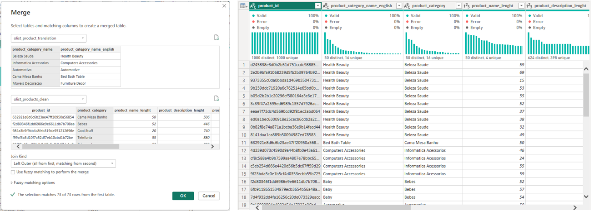
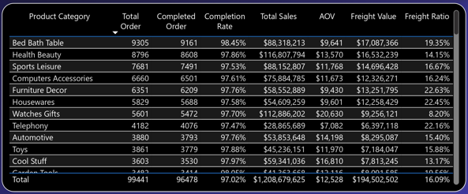
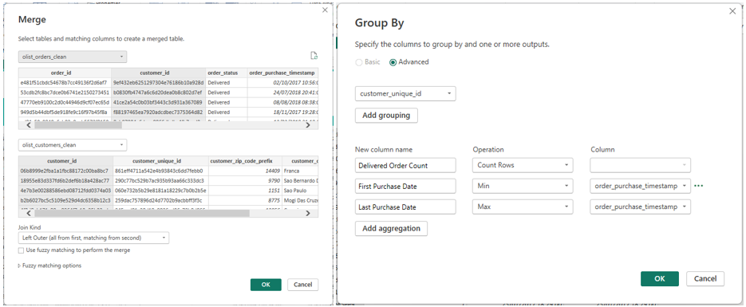
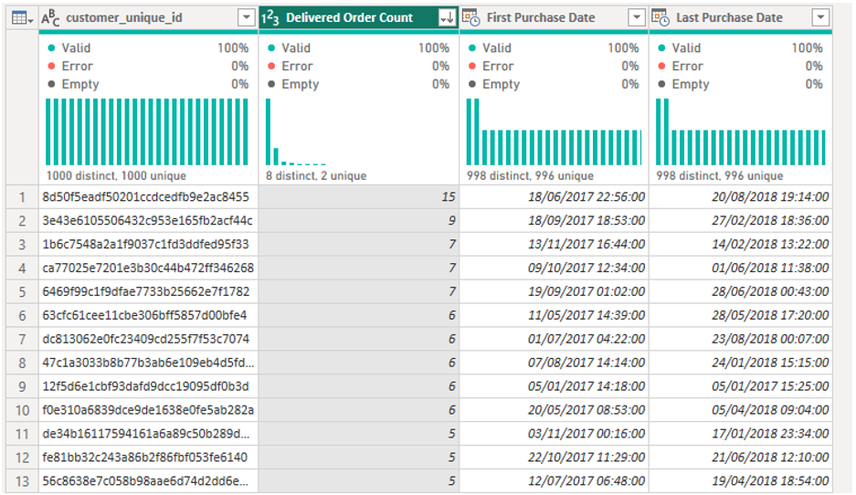

# Data Cleaning and Preparation
### 1. Data Cleaning and Data Quality Checks
- **Convert data types:** ID as Text, dates as Date/DateTime, status as Text, and monetary values ​​as Decimal/Currency.
- **Handle missing values** ​​in approval, carrier delivery, customer delivery, and estimated delivery dates.
- **Handle duplicate data** for fields that should be unique—specifically `order_id` in the `orders` table, and `customer_id` / `customer_unique_id` in the `customers` table.
- **Validate order status values** ​​(e.g., delivered, canceled, shipped, processing, invoiced, and any other statuses present in the source data).
- **Validate for illogical dates—for instance,** cases where the customer delivery date precedes the carrier delivery date.

### 2. Delivery Status Classification
A new column has been added to the Orders table to classify the Delivery Status as `Delivered Early`, `On Time`, `Late`, or `Not Delivered`. Additionally, `Delivery Days` and `Delivery Delay Days` columns have been included to track the duration of the delivery and the number of days delayed, if applicable.
```DAX
Delivery Status =
  VAR ActualDate =
    DATEVALUE(FactOrders[order_delivered_customer_date])
  VAR EstimatedDate =
    DATEVALUE(FactOrders[order_estimated_delivery_date])
  RETURN
  SWITCH(
    TRUE(),
    ISBLANK(FactOrders[order_delivered_customer_date]),
  "Not Delivered",
    ActualDate < EstimatedDate, "Delivered Early",
    ActualDate = EstimatedDate, "On Time",
    ActualDate > EstimatedDate, "Late")
```

### 3. Merge Product Category Name Translation 
Merging the Product Translation table with the Product table using Merge Queries, allowing for the use of product categories in English within visualizations, thereby making them easier to understand.

***The Process on Power Query:***


***The Result on Dashboard View:***


### 4. Merge Table Orders dan Customers as CustomersSummary
Join the Orders table with the Customers table to obtain a summary and the total number of orders for each “unique” customer, allowing you to determine whether a customer has placed repeat orders by using a GROUP BY filter.

***The Process:***

***The Result:***

