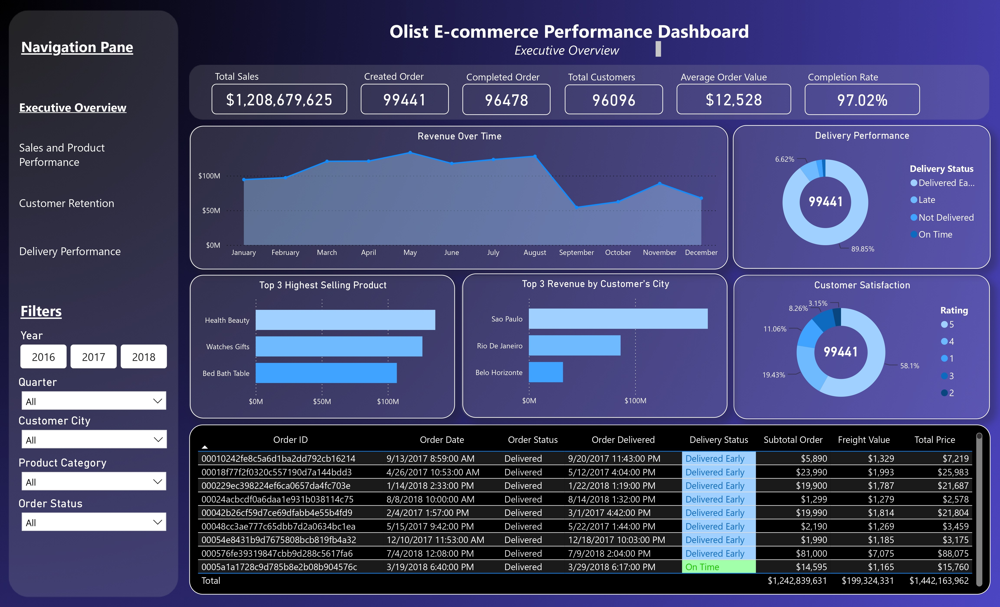
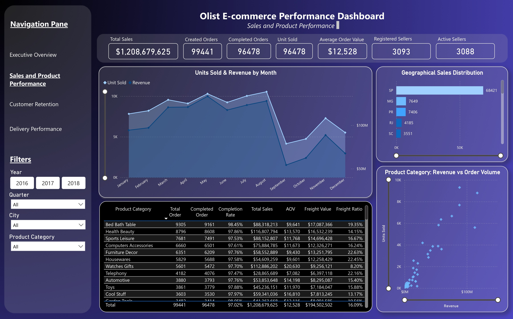
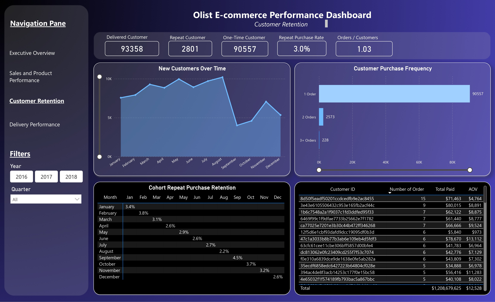
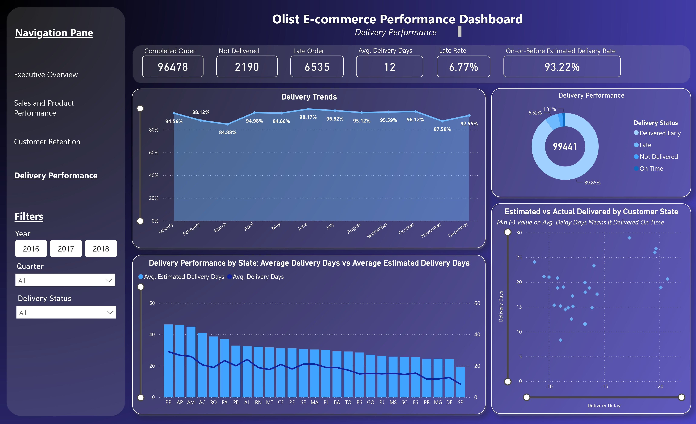

# Olist E-Commerce Performance Analytics
### Sales Performance, Customer Retention & Delivery Insights

An end-to-end data analytics project using Power BI to evaluate the business performance of Olist, a Brazilian e-commerce marketplace, based on its publicly available transactional dataset.

## Project Overview

This project explores historical e-commerce data to identify business performance patterns, evaluate customer purchasing behavior, and assess delivery reliability.

The analysis transforms raw transactional data into actionable business insights through data cleaning, data modeling, DAX calculations, and interactive dashboard development.

## Business Objectives

- Evaluate overall sales performance and revenue trends.
- Identify top-performing product categories and geographic markets.
- Analyze customer purchasing frequency and repeat purchase behavior.
- Measure delivery performance and identify potential operational issues.
- Translate analytical findings into actionable business recommendations.

## Dashboard Preview

### 1. Executive Overview

Provides a high-level overview of revenue, orders, customers, order completion, and customer satisfaction.

### 2. Sales & Product Performance

Analyzes sales trends, product category contributions, order volume, and geographic performance.

### 3. Customer Retention

Evaluates repeat purchasing behavior, customer frequency, and cohort retention.

### 4. Delivery Performance

Evaluates delivery reliability, delivery duration, and late delivery patterns.

## Tools & Technologies
- Power BI Desktop
- Power Query
- DAX
- Microsoft Excel
- Brazilian E-Commerce Public Dataset by Olist

## Analytical Process

1. Business Understanding
2. Data Understanding
3. Data Cleaning & Transformation
4. Data Modeling
5. Exploratory Data Analysis
6. DAX Measures Development
7. Dashboard Development
8. Business Insights & Recommendations

## Key Business Findings

- Repeat Purchase Rate: 3.0%, indicating a relatively low proportion of repeat customers within the analyzed population.
- Orders per Customer: 1.03, showing a low average purchase frequency.
- Late Delivery Rate: 6.77% of delivered orders.
- On-or-Before Estimated Delivery Rate: 93.23%.

*All metrics represent the analyzed dataset and dashboard snapshot. Refer to the detailed documentation for KPI definitions and calculation methodology.*

## Repository Structure

- `01_Dashboard`: Dashboard screenshots and Power BI file.
- `02_Data_Model`: Data model and relationship documentation.
- `03_Data_Dictionary`: Table specifications and column definitions.
- `04_Data_Cleaning`: Data preparation and quality validation.
- `05_DAX_Measures`: DAX formulas and KPI definitions.

## Dataset Source

Brazilian E-Commerce Public Dataset by Olist.

Dataset source: https://www.kaggle.com/datasets/olistbr/brazilian-ecommerce

## Disclaimer

This project is an independent portfolio project developed for educational and analytical purposes. Business recommendations are based on historical data and descriptive analysis, not causal inference.
